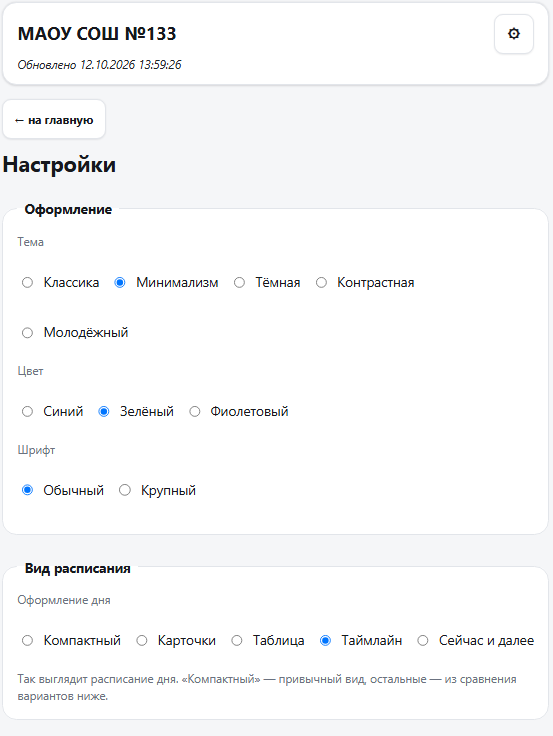

<div align="center">

# 🏫 School Schedule

**Telegram bot + public schedule site with substitution alerts.**

[](https://github.com/itdevlog/raspisanie/actions/workflows/ci.yml)


**🇬🇧 English** · **🇷🇺 [Русский](README.md)**

</div>

---

An async Telegram bot for school schedules with **automatic substitution (change) alerts**.
It pulls data from the **Nikasoft** (Nika-Lux) system, detects changes in real time, and
notifies subscribers. It also serves a **Telegram Mini App** (a web schedule inside
Telegram) and a public **Svelte PWA** site — no login, on a separate `.ru` domain, with
Web Push and offline mode.

Supports **multiple schools**, caching, a local JSON database, background refresh, lesson
reminders, a morning digest, quiet hours, and a full **admin panel**.

## 👥 Who it's for

| Audience | What you need | Where to look |
|-----------|-----------|---------------|
| **Users** (parents, students, teachers) | Just open the bot or the site | [docs/USAGE.md](docs/USAGE.md) |
| **Administrators / self-host** | Deploy the bot and site yourself | [docs/INSTALL.md](docs/INSTALL.md) |
| **Developers** | Understand the architecture and extend it | [docs/ARCHITECTURE.md](docs/ARCHITECTURE.md) |

## 📸 Screenshots

| Telegram bot | Public site |
|--------------|-------------|
|  |  |
|  |  |
|  |  |
|  |  |

## ✨ Features

### 🤖 Telegram bot
- 🏫 **Multiple schools** — switch between schools (e.g. #133, #181, #16, #19, #123).
- 📅 **Schedule** for **Today / Tomorrow / Week** — for **classes**, **teachers**, and **rooms**.
- 🔄 **Substitution monitoring** — a background service checks today and tomorrow;
  `ExchangeDetector` catches new substitutions and sends "before → after" changes
  (`🔄 6. 13:00-13:45 • Math … → Biology …`); a cancellation is shown as
  `↩️ … — substitution cancelled`.
- 👨‍🏫 **Teacher substitutions** — a teacher's schedule accounts for their own
  substitutions (`TEACH_EXCHANGE`).
- 🗓️ **Holiday transfers** — `vacation`/`transfer` from `HOLIDAY_TRANSFER` are handled
  the same as on the site.
- 🔍 **Free rooms** — which rooms are free for the current/next lesson (taking
  substitutions and cancellations into account).
- 🔔 **Subscriptions** — to teachers and rooms: substitution notifications + a list of
  subscriptions in `/settings`.
- ⏰ **Lesson reminders** and 📋 **a morning digest** (one hour before the first lesson,
  shift-aware).
- 🌙 **Quiet hours** — 22:00–7:00 by default; anti-flood and Telegram `RetryAfter` handling.
- 👑 **Admin panel** — school status, forced refresh, user statistics, `/check_exchanges`.
- 📊 **`/status`** — data freshness per school (✅/⚠️/🔴 "Stale").

### 🌍 Public site (Svelte PWA, no login)
- 📅 Class/teacher/room schedule (today/tomorrow/week/month) with **swipes** between days.
- 🎨 Appearance settings: skins (Classic/Minimal/Dark/High-contrast/Youth), accent color,
  font size, **5 schedule views** (Compact/Cards/Table/Timeline/Now & next).
- 🔗 Share links `/s/{school}/{kind}/{name}?date=…`, History routing, SPA fallback.
- 📲 Add to home screen, offline indicator, service worker.
- 🔔 **Web Push** for substitutions (VAPID), with a "do not disturb at night" mode.
- 💬 "Open in Telegram" button and Telegram WebApp theme.

### 🛠️ Infrastructure
- 📦 **origin → edge**: the bot publishes a data snapshot (HMAC-SHA256 + timestamp); the
  edge serves it as a read-only API behind Caddy with auto-TLS — fast from within Russia
  and resilient to channel failures.
- 🧪 **868** pytest + **403** vitest, clean ruff/mypy/svelte-check/eslint, CI on GitHub Actions.
- 🐍 Python 3.11+ · Node 20 (site build).

## 🚀 Quick Start

### Bot — one command (recommended)

```bash
curl -fsSL https://raw.githubusercontent.com/itdevlog/raspisanie/main/manage.sh | bash -s -- install
```

The script sets up the environment, interactively configures `.env` (token from
[@BotFather](https://t.me/BotFather)), and offers a systemd service. Then:

```bash
cd /opt/raspisanie
./manage.sh doctor   # diagnostics
./manage.sh logs     # logs
./manage.sh update   # update with auto-rollback
```

### Public site — one command on the edge host

```bash
sudo EDGE_DOMAIN=schedule.example.ru ./manage.sh edge
```

Full instructions (bot, Mini App, public site, HTTPS, multiple bots) are in
**[docs/INSTALL.md](docs/INSTALL.md)**.

## 🌍 Architecture (brief)

```
Origin (host with the bot): bot + Nikasoft + ExchangeDetector + Web Push
        │  POST /internal/snapshot  (JSON, HMAC-SHA256 + X-Snapshot-Timestamp)
        ▼
Edge (host in Russia): Caddy (.ru, auto-TLS) → FastAPI (read-only API) + Svelte PWA
        ▲  push API is proxied back to the origin (X-Edge-Auth)
   Users
```

- The **snapshot** is published by the origin at startup, once per refresh cycle, and
  after an admin refresh; the edge accepts it only with a valid signature, a
  `timestamp` within ±300 s, and a matching `version`.
- **Channel degradation** — the edge answers from the last copy even when the snapshot is
  stale, showing the data's age (`GET /healthz`).
- More: [docs/ARCHITECTURE.md](docs/ARCHITECTURE.md) and [docs/EDGE.md](docs/EDGE.md).

## 📘 Bot commands

| Command | Description |
|---------|----------|
| `/start` | Main menu: schedule, teachers, rooms, switch school/class |
| `/help` | Help |
| `/status` | Data freshness status per school |
| `/settings` | Notifications, reminders (`⏰`), digest (`📋`), quiet hours (`🌙`), subscriptions |
| `/week <class>` | Week schedule (e.g. `/week 5и`) |
| `/school` | School information |
| `/cancel` | Reset input/search and return to the main menu |
| `/admin` · `/stats` | Admin panel and statistics (`ADMIN_IDS` only) |
| `/check_exchanges` | Force a substitution check and broadcast (admin) |

## 🛠️ Tech stack

| Layer | Technology |
|------|-----------|
| Language | **Python 3.11+** |
| Bot | [python-telegram-bot v22.8](https://github.com/python-telegram-bot/python-telegram-bot) (async, `Application.builder`, `AIORateLimiter`) |
| HTTP/parsing | `httpx`, `re` |
| Web / Mini App | `fastapi` + `uvicorn` (REST API, `/healthz`) |
| Public site | Svelte 5 + Vite + TypeScript (PWA); edge FastAPI from the snapshot; Caddy (auto-TLS) + systemd |
| Web Push | `pywebpush` + `cryptography` (VAPID), Service Worker |
| DB | Local JSON DB `FileDB` (thread-safe, atomic write: `fsync` + `.bak`) |
| Timezone | `zoneinfo` / `TIMEZONE` (default `Asia/Yekaterinburg`) |

## 📚 Documentation

- [docs/README.md](docs/README.md) — documentation index.
- [docs/INSTALL.md](docs/INSTALL.md) — installation and deployment.
- [docs/USAGE.md](docs/USAGE.md) — how to use the bot and site.
- [docs/ARCHITECTURE.md](docs/ARCHITECTURE.md) — project internals.
- [docs/EDGE.md](docs/EDGE.md) · [docs/WIDGET.md](docs/WIDGET.md) — edge server and widget.
- [CHANGELOG.md](CHANGELOG.md) — changelog.

> The documentation is written in Russian.

## ⚠️ Limitations

- The user interface and documentation are in Russian.
- Data comes from the **Nikasoft** system; the bot is tied to schools that use it.
- The public site requires a public `.ru` domain and an edge host with Caddy for HTTPS.

## 📄 License

[MIT](LICENSE). Questions and suggestions — [Issues](https://github.com/itdevlog/raspisanie/issues).
